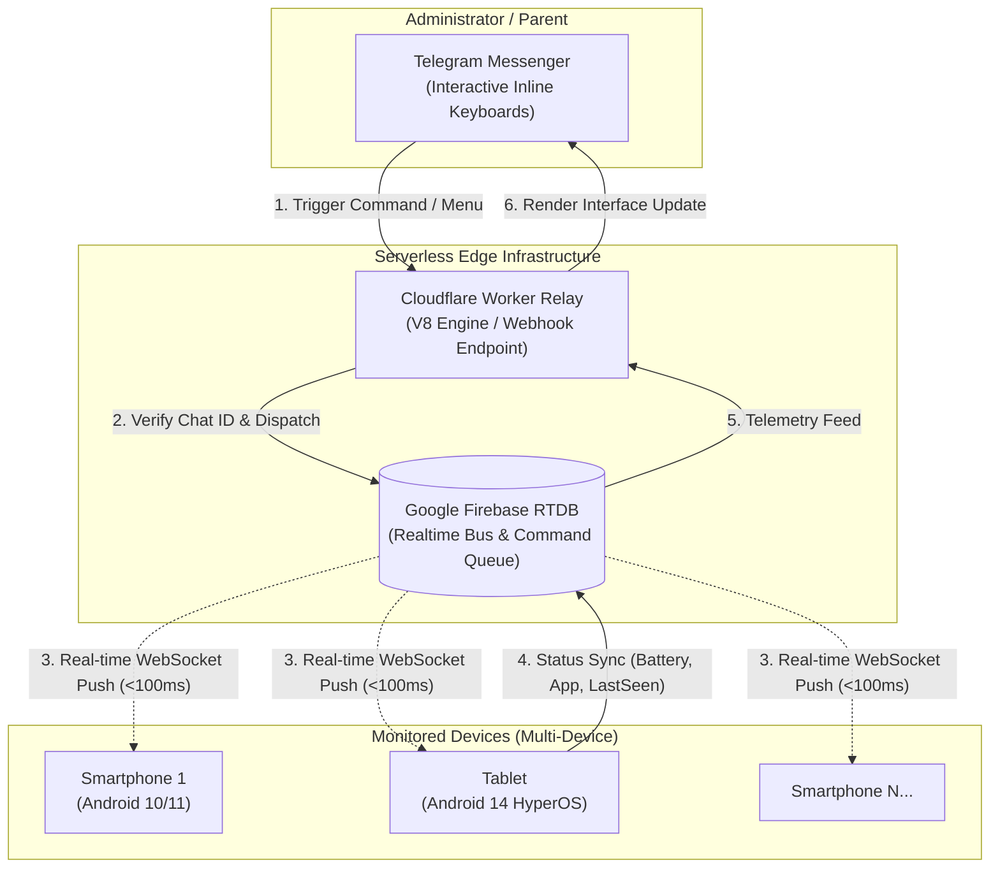

# DwisnuLabs Parental (ChildLock Central System)

[](https://developer.android.com)
[](https://kotlinlang.org)
[](https://workers.cloudflare.com)
[](https://firebase.google.com)
[](https://core.telegram.org/bots)

Sistem pengawasan dan kontrol perangkat Android multi-device berbasis arsitektur terdistribusi: **Serverless Edge (Cloudflare Worker)**, **Real-time Event Push (Google Firebase Realtime Database)**, dan antarmuka kontrol **Telegram Bot API**.

Arsitektur ini dirancang secara *headless* dan hemat daya (*zero-polling*) dengan waktu propagasi perintah di bawah 100 milidetik, tanpa membutuhkan aplikasi pihak orang tua terpisah.

---

## Dokumentasi Teknis

* **[Panduan Onboarding & Setup Lingkungan Pengembang](doc/Environment_Setup_Onboarding.md)**: Panduan instalasi langkah-demi-langkah (Telegram, Firebase, Cloudflare Wrangler CLI, dan Android SDK / ADB).
* **[Business Requirements Document (BRD v2.0.0)](doc/Business_Requirements_Document.md)**: Spesifikasi arsitektur teknis, kamus data Firebase RTDB, dan analisis kebutuhan sistem.

---

## Arsitektur Sistem Terdistribusi



---

## Fitur Utama

* **Zero Parent-App Overhead**:
  Seluruh telemetri dan kendali diakses langsung melalui Telegram Bot. Administrator tidak perlu memasang aplikasi tambahan pada perangkat pengendali.

* **Penguncian Layar Granular & Sesi Berwaktu**:
  Mendukung penguncian instan (`/lock`), pembukaan kunci sementara berbasis durasi (`/unlock 15m`, `/unlock 30m`), dan pembukaan penuh (`/unlock`).

* **Kamuflase Kerusakan Sistem (System Fault Camouflage)**:
  Tampilan penguncian disamarkan sebagai peringatan kerusakan perangkat keras atau sistem (misalnya: *Storage Corruption*, *CPU Overheat 88°C*, *Security Quarantine*, dan *System UI Failure*). Pendekatan ini menghindari atribusi aplikasi kontrol orang tua untuk meminimalkan upaya pembongkaran aplikasi.
  Tersedia mekanisme otentikasi darurat tersembunyi (*Secret Tap Gesture*) pada judul error untuk pembukaan akses oleh administrator.

* **Proteksi Z-Order & Penekanan Picture-in-Picture (PiP)**:
  Menggunakan `TYPE_ACCESSIBILITY_OVERLAY` (layer prioritas 2032) yang merender gembok di atas seluruh elemen visual, termasuk jendela mengambang YouTube (PiP). Sistem secara otomatis menjeda pemutaran audio/video (*audio focus transient*) saat status kunci aktif.

* **Isolasi Jaringan Lokal (Network Kill-Switch)**:
  Memutus akses data internet pada perangkat target menggunakan implementasi Android `VpnService` berbasis sinkhole, tanpa mengganggu jalur penerimaan perintah lokal.

* **Efisiensi Daya Berbasis Event (Zero-Polling)**:
  Memanfaatkan koneksi persistent WebSocket melalui Firebase SDK. Tidak ada background loop berkala yang menguras baterai perangkat.

* **Penyamaran Layanan (Stealth Deployment)**:
  Aplikasi beroperasi secara *headless* tanpa launcher intent pada app drawer dan terdaftar sebagai layanan komponen sistem bawaan di menu pengaturan aplikasi.

---

## Panduan Memulai Cepat (Quick Start)

Untuk rincian setup lengkap, silakan merujuk ke **[Panduan Onboarding Pengembang](doc/Environment_Setup_Onboarding.md)**.

### 1. Inisialisasi Bot Telegram
1. Buat bot baru melalui `@BotFather` di Telegram (`/newbot`) dan catat token API.
2. Dapatkan ID pengguna Telegram Anda melalui `@userinfobot`.

### 2. Konfigurasi Firebase Realtime Database
1. Buat proyek pada [Firebase Console](https://console.firebase.google.com/) dan aktifkan Realtime Database (disarankan region `asia-southeast1`).
2. Daftarkan aplikasi Android dengan package name `com.dwisnulabs.agent`.
3. Unduh `google-services.json` dan letakkan pada direktori `app/` (gunakan `app/google-services.json.example` sebagai referensi struktur).

### 3. Deploy Cloudflare Worker (via CLI)
```bash
cd backend/cloudflare-worker
npx wrangler login
npx wrangler deploy

# Konfigurasi secret terenkripsi:
npx wrangler secret put TELEGRAM_BOT_TOKEN
npx wrangler secret put PARENT_CHAT_ID
npx wrangler secret put FIREBASE_DB_URL

# Registrasi Webhook Telegram:
curl -F "url=https://<WORKER_NAME>.<SUBDOMAIN>.workers.dev" https://api.telegram.org/bot<BOT_TOKEN>/setWebhook
```

### 4. Kompilasi & Pemasangan Agent Android
```bash
# Kompilasi paket APK Debug:
./gradlew assembleDebug

# Instalasi ke perangkat via ADB:
adb install -r app/build/outputs/apk/debug/app-debug.apk

# Konfigurasi izin khusus vendor (Xiaomi MIUI / HyperOS / Android 10-14):
adb shell cmd appops set com.dwisnulabs.agent SYSTEM_ALERT_WINDOW allow
adb shell cmd appops set com.dwisnulabs.agent 10008 allow
adb shell cmd appops set com.dwisnulabs.agent 10020 allow
adb shell cmd appops set com.dwisnulabs.agent 10021 allow
adb shell cmd appops set com.dwisnulabs.agent USE_FULL_SCREEN_INTENT allow
adb shell pm grant com.dwisnulabs.agent android.permission.POST_NOTIFICATIONS
adb shell dumpsys deviceidle whitelist +com.dwisnulabs.agent
adb shell settings put secure enabled_accessibility_services com.dwisnulabs.agent/com.dwisnulabs.agent.DwisnuLabsAccessibilityService
adb shell settings put secure accessibility_enabled 1
```

---

## Kustomisasi Identitas Perangkat

Sistem mendeteksi dan mendaftarkan perangkat baru secara dinamis ke Firebase Realtime Database. Cloudflare Worker otomatis membaca dan menampilkan seluruh perangkat yang aktif di menu Telegram tanpa perlu modifikasi kode backend.

Jika pengembang ingin menetapkan ID khusus atau label nama perangkat:
1. Buka berkas: [`app/src/main/java/com/dwisnulabs/agent/FirebaseDeviceManager.kt`](app/src/main/java/com/dwisnulabs/agent/FirebaseDeviceManager.kt)
2. Sesuaikan pemetaan ID perangkat pada fungsi `resolveDeviceId()`:
   ```kotlin
   return when {
       combined.contains("nama_model_atau_codename") -> "device_anak_1"
       else -> "device_" + model.replace("[^a-zA-Z0-9]".toRegex(), "_").lowercase()
   }
   ```
3. Sesuaikan label tampilan tombol Telegram pada fungsi `resolveDeviceName()`:
   ```kotlin
   return when (devId) {
       "device_anak_1" -> "📱 Smartphone Anak 1"
       "device_padse"  -> "📟 Tablet Belajar"
       else -> Build.MODEL ?: "Perangkat Anak"
   }
   ```
*(Catatan: Jika fungsi di atas tidak diubah, sistem otomatis menggunakan nama model bawaan pabrik dari `Build.MODEL` sebagai label default).*

---

## Struktur Repositori

```text
Parental/
├── app/                       # Modul Aplikasi Android Agent (Kotlin)
│   ├── src/main/java/com/dwisnulabs/agent/
│   │   ├── FirebaseDeviceManager.kt          # Sinkronisasi status & router perintah
│   │   ├── LockOverlayManager.kt             # Manajemen visual overlay (TYPE_ACCESSIBILITY_OVERLAY)
│   │   ├── ScareActivity.kt                  # Antarmuka fullscreen kamuflase
│   │   ├── DwisnuLabsLockService.kt          # Foreground service, keep-alive, & FullScreenIntent
│   │   ├── DwisnuLabsAccessibilityService.kt # Monitoring jendela, pencegahan PiP, & proteksi navigasi
│   │   ├── DwisnuLabsKillSwitchService.kt    # Layanan VPN sinkhole pembatas jaringan
│   │   └── AppState.kt                       # Pengelolaan state lokal
│   ├── google-services.json.example          # Template konfigurasi kredensial Firebase
│   └── build.gradle.kts
├── backend/
│   └── cloudflare-worker/     # Modul Serverless Relay
│       ├── worker.js          # Webhook handler Telegram & dispatcher Firebase
│       ├── wrangler.toml      # Konfigurasi Cloudflare Wrangler
│       └── README.md          # Dokumentasi operasional worker
├── doc/
│   ├── Business_Requirements_Document.md     # Spesifikasi kebutuhan bisnis & arsitektur teknis
│   └── Environment_Setup_Onboarding.md       # Panduan instalasi dan environment pengembang
├── build.gradle.kts
└── settings.gradle.kts
```

---

## Kebijakan Keamanan & Privasi

Repositori ini mengikuti standar keamanan data pengembang:
* Berkas konfigurasi sensitif (`app/google-services.json`) dan variabel lokal (`local.properties`) telah terdaftar di `.gitignore`.
* Kredensial runtime dikelola secara terisolasi melalui fitur rahasia terenkripsi Cloudflare (`wrangler secret put`).
* Kontributor dilarang menyertakan token API, ID personal, atau URL infrastruktur produksi dalam setiap *Pull Request*.

---

## Lisensi

Didistribusikan di bawah lisensi [MIT](LICENSE). Bebas digunakan, dipelajari, dan dikembangkan untuk keperluan pengawasan perangkat keluarga secara mandiri.
