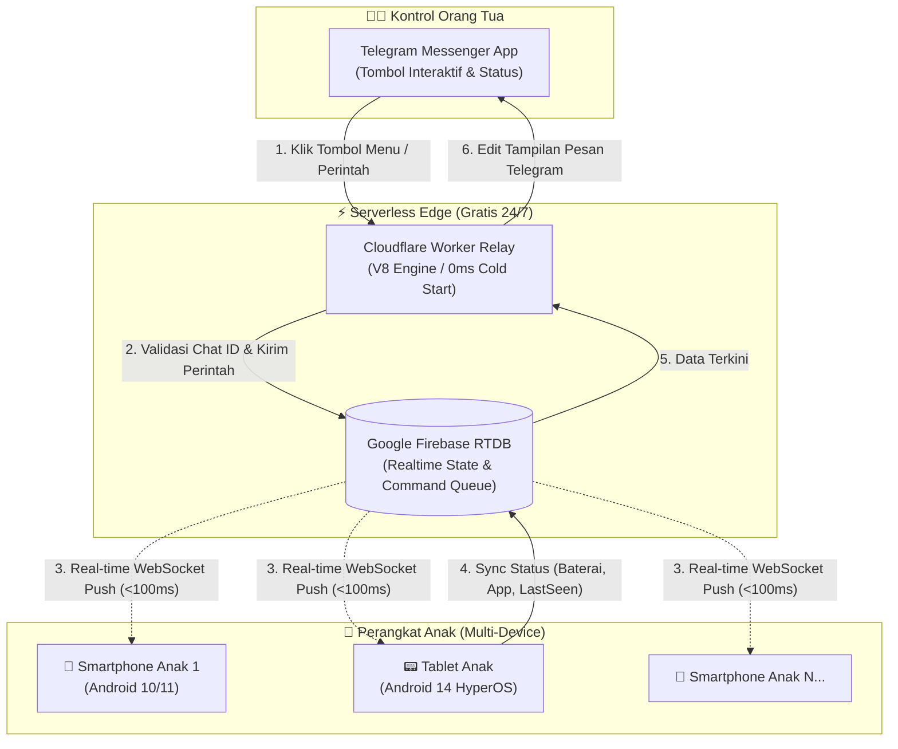

# 🛡️ DwisnuLabs Parental (ChildLock Central System)

[](https://developer.android.com)
[](https://kotlinlang.org)
[](https://workers.cloudflare.com)
[](https://firebase.google.com)
[](https://core.telegram.org/bots)

**Sistem Pengendalian & Pengawasan Gadget Anak Multi-Device Berbasis Serverless Edge (Cloudflare Worker), Real-time Cloud Push (Firebase RTDB), dan Telegram Bot.**

Aplikasi agen kontrol orang tua cerdas untuk Android yang dikendalikan secara terpusat melalui **Telegram Bot**, menggunakan arsitektur *100% Free Serverless Webhook* (**Cloudflare Worker**) dan *Push-Triggered Event* (**Google Firebase Realtime Database**) tanpa menguras baterai (*zero-polling*).

---

## 🧭 Navigasi Dokumentasi Lengkap
* 📖 **[Panduan Lengkap Setup & Onboarding Developer Pemula](doc/Environment_Setup_Onboarding.md)**: Panduan instalasi langkah-demi-langkah dari nol (Telegram, Firebase, Cloudflare via CLI, hingga ADB).
* 📑 **[Business Requirements Document (BRD v2.0.0)](doc/Business_Requirements_Document.md)**: Spesifikasi arsitektur teknis, kamus data skema Firebase, dan rancangan fitur mendalam.

---

## 📱 Arsitektur Sistem Terdistribusi



---

## ✨ Fitur-Fitur Unggulan

* **🎮 100% Zero Parent-App**:
  * Orang tua **tidak perlu** menginstal aplikasi tambahan di HP. Semua kendali dilakukan via chat **Telegram Bot**.
* **🔒 Kunci Layar Instan & Timer Otomatis**:
  * Gembok layar seketika (`/lock`) dan buka kunci dengan durasi waktu (`/unlock 15m` atau `/unlock 30m`).
* **🎭 Layar Kamuflase Gertakan Cerdas (Scare Camouflage)**:
  * Tidak memunculkan kata *"Orang Tua"* atau *"Parental"* di layar anak agar anak tidak merengek.
  * Dilengkapi 4 tema kamuflase error: *Critical Storage Corruption*, *Thermal Overheat 88°C*, *Trojan Security Threat*, dan *System UI Stopped*.
  * Dilengkapi *Secret Emergency Tap* (ketuk judul error 5x cepat) untuk membuka kunci darurat oleh orang tua.
* **🛡️ Proteksi Anti-Bypass & Kebal Picture-in-Picture (PiP)**:
  * Menggunakan `TYPE_ACCESSIBILITY_OVERLAY` (Layer z-order 2032) yang merender gembok di atas seluruh elemen layar, termasuk di atas jendela mengambang YouTube (PiP).
  * Auto-pause audio/video seketika saat perangkat dikunci.
* **🌐 Kill-Switch Internet Lokal (Firewall)**:
  * Memutus seluruh lalu lintas data anak via Android `VpnService` tanpa mematikan koneksi relay perintah.
* **⚡ Super Hemat Baterai (Zero Polling)**:
  * Tidak menggunakan background loop yang memboroskan baterai; mengandalkan event listener WebSocket Firebase.
* **👻 Mode Siluman (Ghost Mode)**:
  * Tanpa ikon di Home Screen/App Drawer dan disamarkan sebagai layanan sistem bawaan di Pengaturan Android.

---

## 🚀 Panduan Cepat Memulai (Quick Start for Developers)

Untuk panduan lengkap dan detail instruksi CLI, silakan baca **[Panduan Onboarding Developer](doc/Environment_Setup_Onboarding.md)**. Berikut ringkasan 4 langkah praktisnya:

### 1. Buat Bot Telegram & Dapatkan Token
* Buka `@BotFather` di Telegram, kirim `/newbot`, lalu simpan `<TELEGRAM_BOT_TOKEN>`.
* Buka `@userinfobot` untuk mendapatkan ID Telegram Anda (`<PARENT_CHAT_ID>`).

### 2. Setup Firebase Realtime Database
* Buat project di [Firebase Console](https://console.firebase.google.com/) dan aktifkan **Realtime Database** (region `asia-southeast1`).
* Daftarkan aplikasi Android dengan package `com.dwisnulabs.agent`, download `google-services.json`, lalu simpan ke folder `app/google-services.json`.

### 3. Deploy Cloudflare Worker (100% Full CLI)
Buka terminal dan masuk ke folder worker:
```bash
cd backend/cloudflare-worker
npx wrangler login
npx wrangler deploy

# Set kredensial aman di Cloudflare:
npx wrangler secret put TELEGRAM_BOT_TOKEN
npx wrangler secret put PARENT_CHAT_ID
npx wrangler secret put FIREBASE_DB_URL

# Sambungkan Webhook ke Telegram:
curl -F "url=https://<NAMA_WORKER>.<SUBDOMAIN>.workers.dev" https://api.telegram.org/bot<TOKEN_BOT>/setWebhook
```

### 4. Build & Install APK ke Perangkat Anak
```bash
# Kompilasi APK
./gradlew assembleDebug

# Pasang ke perangkat via ADB:
adb install -r app/build/outputs/apk/debug/app-debug.apk

# Berikan izin khusus vendor (Xiaomi/HyperOS/Android 10-14):
adb shell cmd appops set com.dwisnulabs.agent SYSTEM_ALERT_WINDOW allow
adb shell cmd appops set com.dwisnulabs.agent 10008 allow
adb shell cmd appops set com.dwisnulabs.agent 10020 allow
adb shell cmd appops set com.dwisnulabs.agent 10021 allow
adb shell cmd appops set com.dwisnulabs.agent USE_FULL_SCREEN_INTENT allow
adb shell pm grant com.dwisnulabs.agent android.permission.POST_NOTIFICATIONS
adb shell dumpsys deviceidle whitelist +com.dwisnulabs.agent
adb shell settings put secure enabled_accessibility_services com.dwisnulabs.agent/com.dwisnulabs.agent.DwisnuLabsAccessibilityService
adb shell settings put secure accessibility_enabled 1
```

---

## 📂 Struktur Repositori

```text
Parental/
├── app/                       # Source Code Android Agent (Kotlin)
│   ├── src/main/java/com/dwisnulabs/agent/
│   │   ├── FirebaseDeviceManager.kt          # Sinkronisasi status & eksekutor perintah
│   │   ├── LockOverlayManager.kt             # Render gembok visual (TYPE_ACCESSIBILITY_OVERLAY)
│   │   ├── ScareActivity.kt                  # Layar kamuflase full-screen
│   │   ├── DwisnuLabsLockService.kt          # Foreground service, keep-alive, & FullScreenIntent
│   │   ├── DwisnuLabsAccessibilityService.kt # Pencegat navigasi & pemblokir PiP
│   │   ├── DwisnuLabsKillSwitchService.kt    # Firewall lokal pembatas internet (VpnService)
│   │   └── AppState.kt                       # Penyimpanan status lokal
│   ├── google-services.json.example          # Template konfigurasi Firebase
│   └── build.gradle.kts
├── backend/
│   └── cloudflare-worker/     # Serverless Telegram Bot Webhook
│       ├── worker.js          # Controller Telegram & Dispatcher Firebase
│       ├── wrangler.toml      # Konfigurasi Cloudflare Wrangler
│       └── README.md          # Panduan CLI Cloudflare Worker
├── doc/
│   ├── Business_Requirements_Document.md     # Spesifikasi kebutuhan bisnis & skema teknis
│   └── Environment_Setup_Onboarding.md       # Panduan instalasi dan environment developer
├── build.gradle.kts
└── settings.gradle.kts
```

---

## 🔒 Kebijakan Keamanan & Privasi (Secrets Policy)

Proyek ini menerapkan standar **Zero Leaked Secrets**:
* File kredensial asli (`app/google-services.json`) dan variabel lokal (`local.properties`) telah terdaftar di `.gitignore`.
* Seluruh rahasia bot dan API Cloudflare dikelola via **Cloudflare Encrypted Secrets** (`wrangler secret put`).
* Jangan pernah melakukan hardcode token Telegram maupun URL database pribadi ke dalam file source code saat mengirimkan *Pull Request*.

---

## 📄 Lisensi
Didistribusikan di bawah Lisensi [MIT](LICENSE) — Bebas digunakan, dimodifikasi, dan dikembangkan untuk keperluan pengawasan gadget keluarga.
