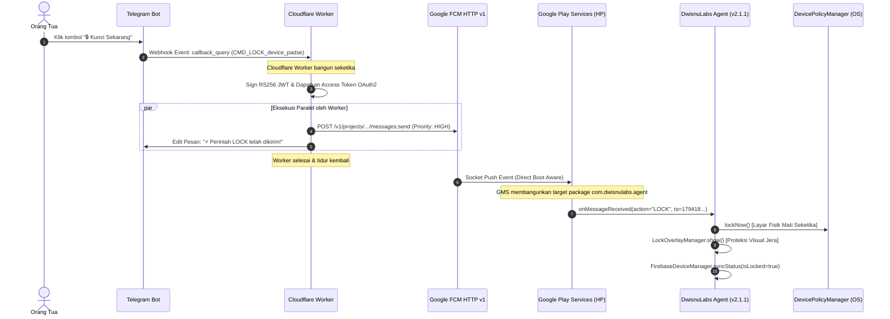

# DwisnuLabs Parental Control: Event-Driven System Architecture (v2.1.1)

Dokumen ini menjelaskan arsitektur sistem, aliran data, dan desain **Event-Driven Architecture (EDA)** yang diterapkan pada platform DwisnuLabs Parental Control.

---

## 1. Konsep Utama: 100% Event-Driven & Zero-Polling

Arsitektur sistem ini dibangun di atas paradigma **Event-Driven (Didorong oleh Kejadian)**. Tidak ada komponen di server maupun di perangkat anak yang menjalankan *loop polling* tanpa henti.

```mermaid
flowchart LR
    subgraph TelegramEvent["1. User Action Event"]
        Parent[🧑‍ Orang Tua di Telegram] -->|Klik Tombol Inline| TGServer[Telegram Server]
    end

    subgraph EdgeWorkers["2. Serverless Event Gateway"]
        TGServer -->|HTTP POST Webhook Event| CF[Cloudflare Worker]
        CF -->|Generate JWT RS256| Auth[OAuth2 FCM Engine]
    end

    subgraph PushAndState["3. Event Dispatchers"]
        CF -->|HTTP PUT Event| RTDB[(Firebase RTDB)]
        Auth -->|FCM HTTP v1 Push Event| FCMServer[Google FCM Cloud]
    end

    subgraph AndroidDevice["4. Android Event Receivers (Tablet / HP Anak)"]
        FCMServer -->|High-Priority Wakeup| GMS[Google Play Services]
        GMS -->|Wake Lock & Intent Event| FCMService[FcmCommandService]
        RTDB -.->|SSE Stream Listener| RTDBListener[FirebaseDeviceManager]
        FCMService --> ActionRouter{Router Perintah}
        RTDBListener --> ActionRouter
        ActionRouter -->|Hardware Lock Event| DPM[DevicePolicyManager.lockNow]
        ActionRouter -->|Visual Overlay Event| Overlay[LockOverlayManager]
    end
```

---

## 2. Peran Dua Jenis "Worker" dalam Sistem

Sistem ini memiliki dua komponen dengan istilah **Worker**, dan keduanya **100% Event-Driven**:

### A. Cloudflare Worker (`backend/cloudflare-worker/worker.js`)
* **Peran**: Serverless Edge Gateway & Event Dispatcher.
* **Karakteristik Event-Driven**:
  - **Stateless & On-Demand**: Tidak ada proses server yang menyala terus menerus. Cloudflare Worker tidur dan hanya bangun ketika ada HTTP Webhook Event dari Telegram.
  - **Zero Cold-Start (< 5ms)**: Berjalan di V8 Isolate edge network Cloudflare global.
  - **Tugas Saat Event Diterima**:
    1. Memvalidasi `chat_id` orang tua (*Authorization Event*).
    2. Menyusun payload perintah (`LOCK`, `UNLOCK`, `NETOFF`, dsb).
    3. Mengirimkan **FCM High-Priority Push Event** menggunakan Web Crypto RS256 OAuth2 ke Google FCM API.
    4. Menulis data perintah ke Firebase Realtime Database (`/devices/{deviceId}/command`).
    5. Mengirim konfirmasi balik ke Telegram (*UI Update Event*).

### B. Android WorkManager Worker (`app/.../StatusSyncWorker.kt`)
* **Peran**: Background Resilience & Periodic Sync Event Consumer.
* **Karakteristik Event-Driven**:
  - **OS-Managed Constraint Event**: Bukan thread yang melakukan `Thread.sleep()`. Pekerjaan ini didaftarkan ke `android.app.job.JobScheduler` bawaan Android.
  - **Trigger**: Android OS hanya memicu event eksekusi setiap 15 menit atau ketika koneksi jaringan perangkat kembali pulih (*network constraint event*).
  - **Tugas Saat Event Terpicu**:
    1. Memastikan foreground service (`DwisnuLabsLockService`) tetap hidup jika sebelumnya terbunuh oleh *memory cleaner*.
    2. Mengirimkan heartbeat dan status baterai terbaru ke Firebase RTDB.
    3. Segera selesai dan melepaskan memori (*release wake lock & process idle*).

---

## 3. Aliran Eksekusi Perintah (Contoh: Event "LOCK")

Berikut adalah urutan kejadian (*sequence*) dari saat orang tua menekan tombol hingga tablet terkunci:

---

## 4. Keunggulan Arsitektur Event-Driven Ini

1. **Hemat Baterai Ekstrem (Zero Idle Consumption)**:
   - HP anak tidak melakukan request polling HTTP berulang-ulang ke server.
   - Baterai hanya terpakai sepersekian miliampere ketika ada event masuk.
2. **Respon Sub-Detik (< 500ms)**:
   - Jalur FCM High-Priority Push dialirkan langsung melalui koneksi persisten Google Play Services yang sudah terintegrasi di kernel Android.
3. **Anti-Kill HyperOS / MIUI 15**:
   - Jika proses aplikasi anak dimatikan oleh pembersih RAM bawaan Xiaomi saat anak membuka game berat (seperti Minecraft/Roblox), **Google Play Services tetap menerima event FCM** dan otomatis menghidupkan kembali aplikasi dalam < 1 detik.
4. **Skalabilitas Multi-Device Tanpa Batas**:
   - Menambah puluhan perangkat anak tidak menambah beban server karena Cloudflare Worker dan Google FCM menangani antrean event secara elastis dan gratis.

