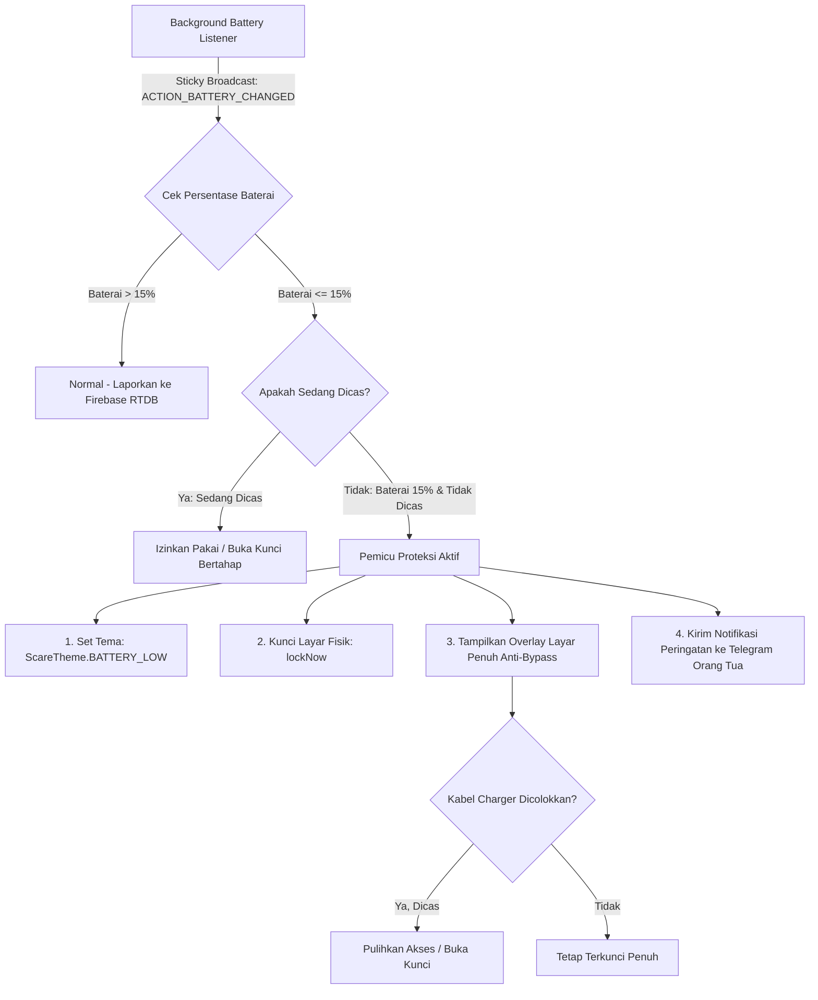

# Feature Plan: Auto-Lock Battery Guard & Overheat Scare (Batas 15%)

Dokumen perencanaan teknis untuk mengimplementasikan fitur proteksi baterai otomatis pada perangkat anak ketika daya baterai mencapai 15% atau lebih rendah.

---

## 1. Latar Belakang & Tujuan
Anak-anak sering kali menggunakan perangkat hingga baterai 0% (mati total), yang dapat merusak kesehatan sel baterai (*battery degradation*) dan memicu kenaikan suhu (*thermal throttle / overheat*).
Fitur ini bertujuan:
1. Memaksa anak berhenti bermain game / menonton video ketika daya tersisa **<= 15%**.
2. Memunculkan tampilan visual jera (*Scare Screen & Overlay*) dengan pesan tegas:
   > **BATRE MAU HABIS dan KEPANASAN. MOHON CAS DEVICE INI AGAR TIDAK RUSAK.**
3. Mematikan layar fisik via `DevicePolicyManager.lockNow()` dan memasang `LockOverlayManager` agar tablet tidak bisa digunakan sampai dicas.

---

## 2. Diagram Alur Kerja (Workflow Diagram)

---

## 3. Spesifikasi Tampilan Visual Layar Jera (`Scare View` & Gambar Visual)

Pada [`ScareActivity.kt`](file:///c:/D/Project/Mix/Parental/app/src/main/java/com/dwisnulabs/agent/ScareActivity.kt) dan [`LockOverlayManager.kt`](file:///c:/D/Project/Mix/Parental/app/src/main/java/com/dwisnulabs/agent/LockOverlayManager.kt):

* **Tema Baru**: `ScareTheme.BATTERY_LOW`
* **Warna Latar**: Hitam pekat (`#000000`) dengan aksen Merah Kritis (`#FF1744`) dan Oranye Panas (`#FF9100`).
* **Elemen Visual Gambar**:
  - **Ilustrasi Robot Android Rusak & Baterai Kritis**: Menampilkan `ImageView` visual robot Android dengan mata 'X' (tanda rusak/pingsan), efek kepulan asap/panas, percikan api, dan ikon baterai 15% merah berkedip.
  - Gambar ini diposisikan di tengah atas sebelum teks peringatan agar anak langsung paham secara visual bahkan sebelum membaca teks.
* **Komposisi Teks**:
  - **Judul (Title)**:  
    `🔋 [BATTERY CRITICAL: 15% & OVERHEAT DETECTED]` (Warna Merah Menyala `#FF1744`)
  - **Isi Pesan (Description)**:  
    `BATRE MAU HABIS dan KEPANASAN!\nSuhu baterai tinggi dan daya berada di batas kritis.\n\nMOHON CAS DEVICE INI AGAR TIDAK RUSAK.`
  - **Instruksi (Instruction)**:  
    `🔌 Hubungkan kabel pengisi daya (charger) sekarang juga!\nPerangkat baru dapat digunakan kembali setelah terisi minimal 35%.`

---

## 4. Komponen Teknis yang Akan Dimodifikasi

1. **`app/src/main/java/com/dwisnulabs/agent/AppState.kt`**:
   - Menambahkan enum `ScareTheme.BATTERY_LOW`.
   - Menambahkan state `var isBatteryLockTriggered: Boolean`.

2. **`app/src/main/java/com/dwisnulabs/agent/DwisnuLabsLockService.kt`**:
   - Mendaftarkan dynamic `BroadcastReceiver` untuk `Intent.ACTION_BATTERY_CHANGED`.
   - Deteksi level: `val level = (rawLevel / scale.toFloat() * 100).toInt()`.
   - Deteksi status cas: `val isCharging = status == BatteryManager.BATTERY_STATUS_CHARGING || status == BatteryManager.BATTERY_STATUS_FULL`.
   - Otomatis memicu lock saat `level <= 15 && !isCharging`.

3. **`app/src/main/java/com/dwisnulabs/agent/ScareActivity.kt` & `LockOverlayManager.kt`**:
   - Menambahkan blok render `when (theme) { ScareTheme.BATTERY_LOW -> ... }`.

4. **`backend/cloudflare-worker/worker.js`**:
   - Menambahkan pilihan tema `THEME_BATTERY_LOW` di menu Telegram *"🎭 Ganti Tema Gertakan"*.
   - Mengirim peringatan otomatis ke chat orang tua jika menerima payload status baterai 15%.

---

## 5. Keputusan Desain Pemulihan (Disepakati)

* **Ambang Kunci (Lock Threshold)**: `<= 15%` (saat tidak dicas).
* **Ambang Buka Kunci (Unlock Threshold)**: Otomatis terbuka kembali setelah perangkat dicas mencapai minimal **35%**. Hal ini menjamin baterai terisi cukup aman dan anak tidak langsung mencabut charger seketika.
* **Manual Override Orang Tua**: Orang tua tetap dapat membuka kunci kapan saja secara langsung melalui tombol Telegram *"🔓 Buka Kunci"* jika diperlukan secara darurat.
