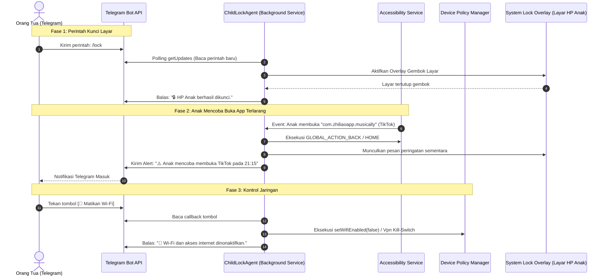
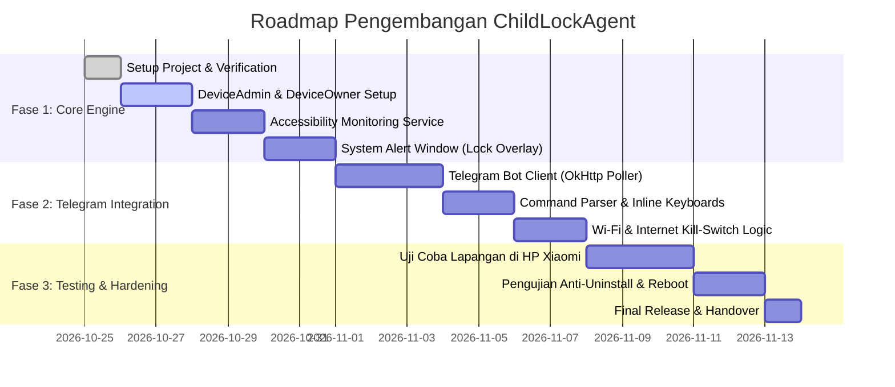

# BUSINESS REQUIREMENTS DOCUMENT (BRD)
## Project: ChildLockAgent (Sistem Parental Control Terpusat via Telegram)

| Dokumen | Nilai |
| :--- | :--- |
| **Versi Dokumen** | 1.0.0 |
| **Status** | Approved & Ready for Implementation |
| **Tanggal Pembuatan** | 26 Oktober 2026 |
| **Target Platform** | Android 8.0 (API 26) s/d Android 14 (API 34) |
| **Target Controller** | Telegram Messenger (Bot API) |
| **Author** | Engineering Team / Antigravity Agent |

---

## 1. Ringkasan Eksekutif & Latar Belakang

### 1.1 Latar Belakang Masalah
Kecanduan gadget pada anak usia dini dan remaja telah menjadi tantangan utama bagi orang tua modern. Sebagian besar solusi *parental control* komersial yang ada saat ini (seperti Google Family Link, Qustodio, atau Bark) memiliki berbagai kelemahan signifikan:
1. **Kompleksitas Aplikasi**: Mengharuskan orang tua menginstal aplikasi khusus yang berat, sering mengalami sinkronisasi lambat, dan memiliki antarmuka yang rumit.
2. **Mudah Dihindari (Bypass)**: Pada perangkat Android vendor tertentu (khususnya Xiaomi/MIUI/HyperOS), aplikasi kontrol sering dimatikan paksa oleh manajemen baterai OS atau dengan mudah dihapus (*uninstall*) oleh anak yang cerdas teknologi.
3. **Ketergantungan Biaya & Cloud Pihak Ketiga**: Mayoritas mengenakan biaya langganan bulanan (*subscription-based*) dan mengumpulkan data analitik anak ke server pihak ketiga.

### 1.2 Visi & Tujuan Solusi
**ChildLockAgent** dirancang sebagai solusi *lightweight*, siluman (*ghost mode*), mandiri, dan berpusat pada kepraktisan orang tua. 
* **Zero Parent-App**: Orang tua **tidak perlu** menginstal aplikasi tambahan di HP mereka. Seluruh pemantauan dan kendali dilakukan 100% melalui **Telegram Bot**.
* **Mode Siluman (Ghost Mode - Tanpa Icon di Dashboard)**: Aplikasi **tidak memiliki icon di Home Screen maupun App Drawer**. Anak tidak akan mengetahui keberadaan aplikasi ini sehingga tidak akan terpikir untuk mengotak-atik atau menghapusnya.
* **Kamuflase Komponen Sistem**: Di menu Pengaturan (*Settings -> Apps*), aplikasi disamarkan sebagai layanan sistem bawaan (misal: *"Android System Core"*).
* **Fleksibilitas Uninstall**: Aplikasi **boleh di-uninstall secara bebas** tanpa mengunci sistem secara agresif. Orang tua dapat menghapusnya kapan saja dengan mudah (via ADB atau perintah Telegram), tanpa repot membuka kunci Device Owner.
* **Kontrol Granular Realtime**: Mendukung penguncian layar dengan kamuflase kerusakan, pemutusan koneksi Wi-Fi/Internet seluler, serta daftar hitam (*blacklist*) aplikasi.

---

## 2. Stakeholder & Persona Pengguna

```
+---------------------------------------------------------------------------------+
|                                 STAKEHOLDERS                                    |
+----------------------------------------+----------------------------------------+
| 1. Orang Tua (Controller/Admin)        | 2. Anak (End User / Monitored Device)   |
| • Memegang kendali penuh atas HP anak  | • Mengoperasikan perangkat Android     |
| • Mengirim instruksi via Telegram      | • Menerima notifikasi edukatif         |
| • Menerima telemetri dan log realtime  | • Terikat pada aturan dan batas waktu  |
+----------------------------------------+----------------------------------------+
```

---

## 3. Ruang Lingkup Proyek (Scope of Work)

### 3.1 In-Scope (Fitur Utama)
1. **Telegram Remote Interface**:
   * Pengendalian melalui bot Telegram menggunakan *Slash Commands* dan tombol interaktif (*Inline Keyboards*).
   * Otentikasi ketat: Hanya merespons Telegram ID/Chat ID orang tua yang sah (whitelist).
2. **Remote Screen Locking & Overlay**:
   * Kunci layar instan via Telegram (`/lock`).
   * Buka kunci sementara dengan durasi otomatis (`/unlock 30m`).
   * Layar penutup (*System Alert Window*) yang tidak bisa di-minimize atau ditutup saat mode terkunci aktif.
3. **Manajemen Jaringan (Wi-Fi & Internet Kill-Switch)**:
   * Menyalakan/mematikan Wi-Fi secara remote (`/wifi on`, `/wifi off`).
   * Firewall lokal (*VpnService*) untuk memutus seluruh koneksi data (Wi-Fi dan Seluler) tanpa mematikan aplikasi penting (misal: WhatsApp keluarga tetap bisa dihubungi).
4. **App Monitoring & Blocking**:
   * Deteksi aplikasi foreground secara instan via `AccessibilityService`.
   * Pemblokiran aplikasi spesifik (YouTube, TikTok, Mobile Legends, Roblox, dll.).
   * Notifikasi otomatis ke Telegram orang tua ketika anak mencoba membuka aplikasi terlarang.
5. **Mode Siluman (Ghost Mode & Stealth)**:
   * **Tanpa Icon di Dashboard**: Tidak ada icon di Home Screen atau App Drawer. Anak tidak akan tahu ada aplikasi pengawas terpasang.
   * **Kamuflase Komponen Sistem**: Disamarkan sebagai *"Android System Core"* dengan icon sistem standar di menu Pengaturan.
   * **Fleksibilitas Uninstall**: Bebas di-uninstall kapan saja oleh orang tua (via ADB atau perintah Telegram) tanpa kuncian Device Owner yang kaku.
   * Auto-start saat HP dinyalakan kembali (*Boot Completed Receiver*).
6. **Telemetri & Status Perangkat**:
   * Pengecekan status baterai, level sinyal, koneksi jaringan, dan aplikasi yang sedang aktif di layar.

### 3.2 Out-of-Scope (Bukan Target Proyek)
* Tidak ada fitur penyadapan mikrofon/kamera rahasia (*non-spyware policy*).
* Tidak menyediakan panel web multi-tenant (proyek ditujukan untuk *self-hosted/personal family use*).
* Tidak memerlukan publikasi ke Google Play Store (instalasi internal via ADB).

---

## 4. Arsitektur Sistem & Alur Kerja

### 4.1 Diagram Alur Komunikasi



### 4.2 Strategi Koneksi (Fase 1 vs Fase 2)
* **Fase 1 (Direct Telegram Client - Implementasi Sekarang)**:
  * HP anak bertindak sebagai klien HTTPS langsung ke endpoint `https://api.telegram.org/bot<TOKEN>/`.
  * Menggunakan interval polling dinamis:
    * **Layar Aktif**: Polling setiap 3–5 detik (responsif terhadap perintah orang tua).
    * **Layar Mati / Tidur**: Polling diturunkan ke 30–60 detik untuk efisiensi baterai.
  * *Keunggulan*: Tidak membutuhkan server cloud pihak ketiga, tidak butuh biaya hosting, langsung jalan dari APK.
* **Fase 2 (Hybrid Cloudflare / Firebase - Opsional di Masa Depan)**:
  * Menghubungkan Telegram Webhook ke Cloudflare Worker gratis, lalu men-trigger pesan push via Firebase Cloud Messaging (FCM) saat ada perintah darurat.

---

## 5. Kebutuhan Fungsional Rinci (Functional Requirements)

### FR-1: Remote Control via Telegram Bot
* **FR-1.1**: Sistem harus melakukan verifikasi `Chat ID` pengirim pesan. Pesan dari pengguna selain orang tua yang terdaftar harus diabaikan secara diam-diam (*silent drop*).
* **FR-1.2**: Sistem harus menyediakan menu interaktif berupa **Inline Keyboard Buttons** untuk mempermudah eksekusi cepat tanpa perlu mengetik manual.
* **FR-1.3**: Sistem harus mendukung daftar perintah dasar berikut:

| Perintah Telegram | Argumen | Fungsi & Respon Sistem (Human-Friendly) |
| :--- | :--- | :--- |
| `/start` | - | Menampilkan salam pembuka dan tombol menu utama kendali. |
| `/status` | - | Melaporkan status terkini (baterai, status kunci, app aktif, status Wi-Fi/Internet, durasi hari ini). |
| `/lock` | `[alasan]` | Menutup layar seketika dengan overlay gembok dan memblokir interaksi. |
| `/unlock` | `[durasi]` | Membuka kunci layar. Contoh: `/unlock 30m` (membuka selama 30 menit lalu terkunci otomatis). |
| `/wifi` | `on` / `off` | Mengaktifkan atau menonaktifkan adapter Wi-Fi di HP anak. |
| `/internet` | `on` / `off` | Mengaktifkan/mematikan firewall lokal (Internet Kill-Switch total). |
| `/block` | `[nama_app]` | **Cukup ketik nama umum** (misal: `/block youtube`, `/block roblox`, `/block tiktok`). Sistem otomatis mencocokkan ke package Android. |
| `/unblock` | `[nama_app]` | Membuka blokir aplikasi berdasarkan nama umum (misal: `/unblock youtube`). |
| `/apps` | - | **Interactive App Picker**: Menampilkan daftar tombol nama aplikasi ber-emoji status (🟢 Aktif / 🔴 Terblokir). Orang tua cukup ketuk tombol untuk toggle blokir. |
| `/help` | - | Menampilkan dokumentasi lengkap cara penggunaan perintah. |

---

### FR-2: Manajemen Kunci Layar & Overlay (Camouflage & Scare System)
* **FR-2.1**: Layar gembok (*lock overlay*) harus dibangun menggunakan window type `TYPE_APPLICATION_OVERLAY` dengan bendera `FLAG_NOT_TOUCH_MODAL` dan `FLAG_LAYOUT_IN_SCREEN`.
* **FR-2.2 (Kebijakan Anti-Branding Orang Tua & Efek Jera)**:
  * **DILARANG KERAS** memunculkan kata *"Orang Tua"*, *"Parental"*, *"ChildLock"*, atau *"Admin"* di layar anak, agar anak tidak mengetahui bahwa HP sedang dikendalikan dan tidak merengek minta dibuka.
  * Tampilan layar gembok harus menggunakan **Tema Kamuflase Kerusakan / Keamanan Sistem (Scare Tactics)** untuk menciptakan efek jera, membuat anak panik/takut, dan berhenti bermain HP dengan sendirinya.
* **FR-2.3 (Pilihan Tema Kamuflase Layar Gembok)**:
  1. **Tema 1 (Default - Sistem Rusak / Storage Corrupted)**:
     * Layar hitam monospace bergaya recovery Android:
       `[ ⚠️ SYSTEM ERROR 0x8849F - KERNEL CRITICAL ]`
       `CRITICAL STORAGE CORRUPTION DETECTED.`
       `Sistem memori internal mengalami kegagalan baca/tulis akibat beban berlebih.`
       `Layar dinonaktifkan sementara untuk mencegah kerusakan permanen pada chipset dan baterai.`
       `DIANJURKAN: Diamkan perangkat selama 45–60 menit dalam kondisi dingin dan jangan dinyalakan!`
  2. **Tema 2 (CPU & Baterai Overheat / Bahaya Panas)**:
     * Tampilan peringatan hardware termal:
       `[ 🔥 TEMPERATURE ALERT: CPU 88°C - OVERHEATED ]`
       `Suhu prosesor melampaui ambang batas aman. Risiko kerusakan hardware permanen.`
       `Sistem dimatikan otomatis untuk pendinginan darurat.`
  3. **Tema 3 (Security Threat / Terindikasi Hack & Malware)**:
     * Tampilan security warning:
       `[ 🛡️ ANDROID SECURITY PROTOCOL - THREAT DETECTED ]`
       `Penyusupan mencurigakan / trojan berbahaya terdeteksi di jaringan perangkat ini.`
       `Sistem keamanan telah mengisolasi perangkat untuk mencegah kebocoran data.`
* **FR-2.4**: Tombol *Back*, *Home*, dan *Recent Apps* harus dinetralisir ketika layar overlay sedang aktif menggunakan bantuan `AccessibilityService`. Form darurat / PIN rahasia untuk orang tua disamarkan (misal: mengetuk teks error 5x secara cepat untuk memunculkan input PIN).

---

### FR-3: Monitoring & Pemblokiran Aplikasi (App Interceptor & Fake Crash)
* **FR-3.1**: `AccessibilityService` harus memantau event `TYPE_WINDOW_STATE_CHANGED`.
* **FR-3.2 (Fake Crash & Error Simulation)**:
  * Ketika package aplikasi yang dibuka cocok dengan daftar *Blacklist*, sistem **TIDAK BOLEH** menampilkan pesan "dibatasi orang tua".
  * Sistem harus menampilkan **Dialog Fake Crash bawaan Android** seolah-olah aplikasi tersebut rusak sendiri:
    1. Dialog tiruan sistem: *"Sayangnya, [Nama App] terus berhenti."* atau *"Gagal memuat aset aplikasi (Error 404: Corrupted Data)."*
    2. Langsung mengeksekusi `performGlobalAction(GLOBAL_ACTION_HOME)` untuk melempar anak kembali ke layar utama.
    3. Mengirim notifikasi otomatis ke Telegram orang tua dalam waktu maksimal 3 detik.
* **FR-3.3**: Fitur pembatasan jam tidur (*Bedtime Mode*): Sistem otomatis mengaktifkan mode kamuflase sistem rusak pada rentang jam istirahat malam (misal: 21:00 – 06:00).
* **FR-3.4 (Zero-Effort Package Name Resolution)**: 
  * Orang tua **tidak perlu** mengingat atau mengetik nama package sistem (seperti `com.zhiliaoapp.musically` atau `com.google.android.youtube`).
  * Sistem agen di Android otomatis membaca label nama aplikasi yang ramah manusia (`PackageManager.getApplicationLabel()`).
  * Jika orang tua mengetik perintah teks, sistem mendukung pencarian nama populer secara cerdas / *case-insensitive* (contoh: `/block youtube`, `/block roblox`, `/block tiktok`, `/block ff`).
* **FR-3.5 (1-Click Block dari Alert Notifikasi)**:
  * Setiap kali anak membuka aplikasi (terutama aplikasi baru atau game yang belum diblokir), bot Telegram mengirimkan laporan dengan tombol aksi instan:
    ```text
    📱 Anak sedang membuka: Mobile Legends: Bang Bang
    Waktu buka: 16:30 | Pemakaian: 5 menit
    [ 🚫 Blokir Game Ini ]   [ ⏳ Izinkan 30 Menit ]   [ 忽略 Abaikan ]
    ```
  * Orang tua cukup menekan tombol `[ 🚫 Blokir Game Ini ]` tanpa mengetik satu huruf pun.
* **FR-3.6 (Interactive App Picker & Category Presets)**:
  * Menu `/apps` menampilkan daftar tombol inline berisi aplikasi-aplikasi yang terpasang di HP anak, lengkap dengan status visualnya (`🟢 Boleh` / `🔴 Terblokir`). Mengetuk tombol tersebut akan langsung membalikkan (*toggle*) status izin aplikasi.
  * Mendukung tombol blokir cepat per kategori: `[ 🚫 Blokir Semua Game ]`, `[ 🚫 Blokir Sosmed ]`, dan `[ 🚫 Blokir Streaming ]`.

---

### FR-4: Manajemen Jaringan & Internet Kill-Switch
* **FR-4.1 (Wi-Fi Control)**:
  * Melalui hak akses **Device Owner**, sistem mengeksekusi perintah manajemen Wi-Fi tanpa menampilkan dialog persetujuan pengguna.
* **FR-4.2 (Network Firewall via Local VPN)**:
  * Menggunakan Android `VpnService` lokal yang merutekan paket data ke antarmuka virtual kosong (*black hole*).
  * **Whitelist Khusus**: Protokol API Telegram dan aplikasi darurat (misal: WhatsApp orang tua) tetap diizinkan melewati firewall agar perintah remote `/internet on` tetap dapat diterima oleh HP anak.

---

### FR-5: Mode Siluman (Ghost Mode) & Manajemen Uninstall
* **FR-5.1 (Tanpa Icon Launcher / Headless Dashboard)**:
  * Manifest aplikasi **TIDAK MENDAFTARKAN** intent filter `android.intent.category.LAUNCHER`.
  * Aplikasi tidak akan pernah memiliki icon di Home Screen, App Drawer, maupun menu aplikasi utama.
  * Anak tidak akan menyadari bahwa ada aplikasi tambahan yang terpasang di HP-nya.
* **FR-5.2 (Kamuflase Nama & Icon di Pengaturan Sistem)**:
  * Di daftar aplikasi Android (*Settings -> Apps / Kelola Aplikasi*), aplikasi disamarkan dengan label komponen sistem: `"Android System Core"` atau `"System Health Service"` dengan icon standar roda gigi / sistem Android.
  * Anak tidak akan mencurigai aplikasi ini sebagai aplikasi pihak ketiga, melainkan menganggapnya sebagai bagian dari 100+ layanan inti OS Android.
* **FR-5.3 (Kemudahan Uninstall bagi Orang Tua)**:
  * Aplikasi **boleh dan dapat di-uninstall dengan mudah** kapan saja oleh orang tua tanpa harus terjebak kuncian Device Owner:
    1. **Cara 1 (Via ADB Terminal Laptop)**:
       ```powershell
       adb uninstall com.dwisnulabs.agent
       ```
    2. **Cara 2 (Via Perintah Telegram)**:
       Orang tua dapat mengirim perintah `/self_destruct` atau `/uninstall` untuk membersihkan data aplikasi dan mencabut layanan secara mandiri.
    3. **Cara 3 (Via Menu Settings HP)**:
       Orang tua dapat membuka *Settings -> Apps*, mencari `"Android System Core"`, dan menekan tombol *Uninstall* secara normal.

---

## 6. Kebutuhan Non-Fungsional (Non-Functional Requirements)

| Kategori | Parameter | Spesifikasi & Toleransi |
| :--- | :--- | :--- |
| **Reliability** | Uptime Layanan | Service harus bertahan hidup 24/7 dan otomatis restart jika dimatikan paksa (*START_STICKY* + Accessibility Heartbeat). |
| **Performance** | Latensi Eksekusi | Perintah dari Telegram harus dieksekusi di HP anak dalam waktu ≤ 5 detik pada mode aktif. |
| **Resource Usage** | Konsumsi Baterai | Pemakaian baterai rata-rata tidak boleh melebihi 2–4% per hari dengan interval polling adaptif. |
| **Resource Usage** | Konsumsi RAM | Penggunaan memori RAM latar belakang tidak boleh melebihi 40 MB. |
| **Security** | Otorisasi Akses | Token Telegram Bot disimpan secara aman; verifikasi ketat pada level `chat.id` pengirim. |
| **Compatibility** | Dukungan Versi OS | Kompatibel penuh dari Android 8.0 (Oreo) hingga Android 14 (Upside Down Cake), termasuk MIUI/HyperOS Xiaomi. |

---

## 7. Rincian Izin & Komponen Teknis Android (Technical Manifest)

### 7.1 Daftar Permissions yang Dibutuhkan
```xml
<!-- Akses Jaringan untuk Komunikasi ke Telegram -->
<uses-permission android:name="android.permission.INTERNET" />
<uses-permission android:name="android.permission.ACCESS_NETWORK_STATE" />
<uses-permission android:name="android.permission.ACCESS_WIFI_STATE" />
<uses-permission android:name="android.permission.CHANGE_WIFI_STATE" />

<!-- Tampilan Kunci Layar (Overlay) -->
<uses-permission android:name="android.permission.SYSTEM_ALERT_WINDOW" />

<!-- Layanan Latar Belakang & Booting -->
<uses-permission android:name="android.permission.FOREGROUND_SERVICE" />
<uses-permission android:name="android.permission.FOREGROUND_SERVICE_SPECIAL_USE" />
<uses-permission android:name="android.permission.RECEIVE_BOOT_COMPLETED" />
<uses-permission android:name="android.permission.WAKE_LOCK" />

<!-- Query Aplikasi Terpasang (Android 11+) -->
<uses-permission android:name="android.permission.QUERY_ALL_PACKAGES" />
```

### 7.2 Komponen Arsitektur Utama
1. **`LockService.kt`** (Foreground Service):
   * Bertindak sebagai *orchestrator*, memelihara koneksi background worker, dan mengelola state aplikasi (`LOCKED`, `UNLOCKED`, `RESTRICTED`).
2. **`TelegramPoller.kt`**:
   * Modul komunikasi HTTPS ringan berbasis `OkHttp` yang menangani `getUpdates`, parsing JSON instruksi, dan pengiriman pesan balik (`sendMessage`).
3. **`AppMonitorAccessibilityService.kt`**:
   * Menangkap pergantian jendela aplikasi secara realtime dan mencegah navigasi ke aplikasi yang diblokir.
4. **`DeviceAdminReceiver.kt`**:
   * Titik masuk Device Policy Manager (DPM) untuk kebijakan level sistem dan proteksi anti-uninstall.
5. **`LockOverlayView.kt`**:
   * Tampilan antarmuka gembok yang digambar langsung ke WindowManager Android.

---

## 8. Matriks Interaksi & Tombol Telegram (UI Orang Tua)

Orang tua akan melihat keyboard interaktif yang ramah pengguna di Telegram tanpa perlu menghafal package name:

### 8.1 Menu Utama Kendali (Home Remote)
```text
+-------------------------------------------------------+
| 📱 KENDALI HP ANAK (ChildLockAgent)                   |
| Status: AKTIF | Baterai: 82% | App: YouTube           |
+-------------------------------------------------------+
|  [ 🔒 KUNCI SEKARANG ]   |   [ 🔓 BUKA KUNCI ]        |
+--------------------------+----------------------------+
|  [ ⏳ BUKA 15 MENIT ]    |   [ ⏳ BUKA 30 MENIT ]     |
+--------------------------+----------------------------+
|  [ 📶 MATIKAN WI-FI ]    |   [ 🌐 BLOKIR INTERNET ]   |
+--------------------------+----------------------------+
|  [ 📱 KELOLA APLIKASI ]  |   [ ⚙️ STATUS PERANGKAT ]  |
+-------------------------------------------------------+
```

### 8.2 Menu Kelola Aplikasi (Interactive App Picker via `/apps`)
Orang tua cukup mengetuk tombol untuk mengubah status blokir:
```text
+-------------------------------------------------------+
| 📱 KELOLA DAFTAR APLIKASI ANAK                        |
| Ketuk nama aplikasi untuk Mengizinkan (🟢) / Blokir (🔴) |
+-------------------------------------------------------+
|  [ 🔴 YouTube (Diblokir) ]  |  [ 🟢 WhatsApp (Boleh) ] |
+-----------------------------+--------------------------+
|  [ 🔴 TikTok (Diblokir) ]   |  [ 🔴 Roblox (Diblokir) ]|
+-----------------------------+--------------------------+
|  [ 🟢 Google Classroom ]    |  [ 🔴 Mobile Legends ]   |
+-----------------------------+--------------------------+
|  [ 🚫 BLOKIR SEMUA GAME ]   |  [ 🚫 BLOKIR SOSMED ]    |
+-------------------------------------------------------+
|  [ ⬅️ KEMBALI KE MENU UTAMA ]                         |
+-------------------------------------------------------+
```

### 8.3 Notifikasi Cerdas & Tombol Instan (1-Click Action)
Saat anak membuka game atau aplikasi apa pun di HP:
```text
+-------------------------------------------------------+
| ⚠️ PERINGATAN: ANAK MEMBUKA APLIKASI                   |
| Aplikasi: Mobile Legends: Bang Bang                   |
| Waktu Buka: 16:30 | Pemakaian Hari Ini: 15 menit      |
+-------------------------------------------------------+
|  [ 🚫 BLOKIR GAME INI ]  |  [ ⏳ BERI WAKTU 30 MENIT ]|
+-------------------------------------------------------+
|  [ 🙈 ABAIKAN ]                                       |
+-------------------------------------------------------+
```

### 8.4 Pilihan Tema Gertakan / Kamuflase (Scare Mode Selector)
Orang tua dapat memilih gaya kamuflase yang paling efektif untuk anaknya:
```text
+-------------------------------------------------------+
| 🎭 PILIH TEMA GERTAKAN / KAMUFLASE LAYAR              |
| Efek visual saat layar dikunci atau app diblokir:      |
+-------------------------------------------------------+
|  [ ⚠️ SISTEM RUSAK / ERROR ]                          |
|  (Layar recovery hitam, pesan memori internal jebol)  |
+-------------------------------------------------------+
|  [ 🔥 OVERHEAT PANAS 88°C ]                           |
|  (Peringatan baterai/CPU panas, bahaya terbakar)      |
+-------------------------------------------------------+
|  [ 🛡️ TERINDIKASI VIRUS / HACK ]                     |
|  (Peringatan Android Firewall: Penyusupan berbahaya)  |
+-------------------------------------------------------+
|  [ 💥 FAKE CRASH (APP RUSAK SENDIRI) ]                |
|  (Dialog sistem bawaan: "Aplikasi terus berhenti")    |
+-------------------------------------------------------+
|  [ ⬅️ KEMBALI KE MENU UTAMA ]                         |
+-------------------------------------------------------+
```

---

## 9. Rencana Rilis & Roadmap Implementasi



---

## 10. Persetujuan & Tanda Tangan

Dokumen spesifikasi kebutuhan bisnis ini menjadi acuan tunggal dan sah untuk perancangan kode, struktur database internal, dan pengujian penerimaan sistem (*User Acceptance Test*).

* **Disetujui oleh**: Pemilik Proyek / Product Owner
* **Status**: Siap untuk eksekusi implementasi teknis.
