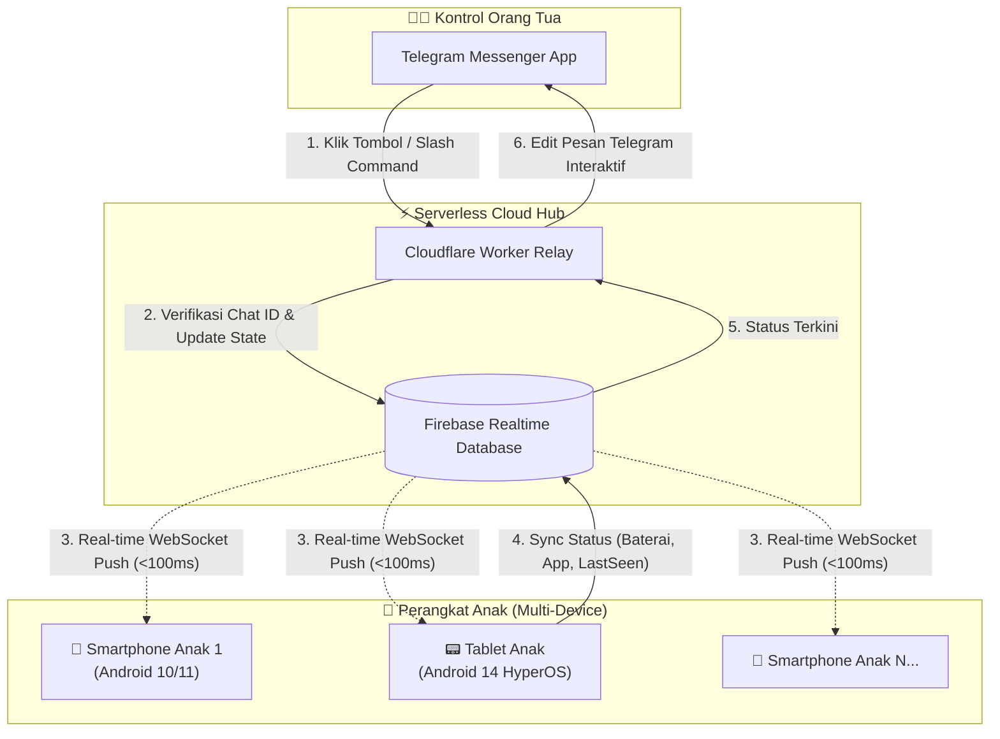
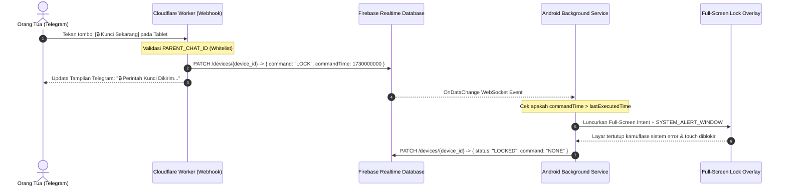

# BUSINESS REQUIREMENTS DOCUMENT (BRD)
## Project: Multi-Device Stealth Parental Control System (Cloudflare Worker & Firebase RTDB)

| Dokumen | Nilai |
| :--- | :--- |
| **Versi Dokumen** | 2.0.0 (Production Verified & Multi-Device Ready) |
| **Status** | Approved & Fully Implemented |
| **Target Platform** | Android 8.0 (API 26) s/d Android 14+ (API 34/35) — Termasuk Xiaomi MIUI/HyperOS |
| **Target Controller** | Telegram Messenger (Inline Keyboards & Slash Commands) |
| **Serverless Relay** | Cloudflare Workers (V8 Edge Computing Engine) |
| **Realtime Bus** | Firebase Realtime Database (Google Cloud) |
| **Klasifikasi** | Open Specification (Privacy-Safe & Sanitized Template) |

---

## 1. Ringkasan Eksekutif & Arsitektur Generasi 2

### 1.1 Latar Belakang Masalah
Aplikasi *parental control* komersial yang beredar di pasaran memiliki kelemahan mendasar:
1. **Aplikasi Orang Tua yang Lambat & Berat**: Mengharuskan orang tua memasang aplikasi terpisah dengan UI berbelit-belit dan pembaruan status yang lambat.
2. **Mudah Dicurigai & Dihapus Anak**: Ikon aplikasi di beranda memicu anak mencari celah untuk menghapus (*uninstall*) atau mematikan paksa aplikasi pengawas.
3. **Agresivitas OS Vendor (MIUI / HyperOS / ColorOS)**: Sistem operasi modern secara agresif membunuh layanan latar belakang (*background services*) dan memblokir jendela popup/overlay jika tidak dikonfigurasi dengan izin khusus.
4. **Masalah Polling Telegram Langsung di HP Anak (Kelemahan Gen-1)**:
   * Menghubungkan HP anak langsung ke Telegram API via *long-polling* menguras baterai HP anak secara konstan.
   * Sangat sulit mengelola banyak perangkat (multi-device) secara serentak hanya dengan satu bot token jika semua HP berebut mengambil pesan (*getUpdates race condition*).

### 1.2 Solusi Generasi 2 (Implementasi Nyata)
Sistem ini mengadopsi arsitektur **Tri-Layer Terdistribusi**:
* **Telegram Bot**: Sebagai satu-satunya antarmuka kontrol orang tua (100% tanpa aplikasi orang tua, cukup chat via Telegram).
* **Cloudflare Worker (Serverless Edge Hub)**: Menerima Webhook Telegram secara instan (0ms cold start, gratis 100.000 request/hari), memvalidasi otentikasi orang tua, dan bertindak sebagai pengatur lalu lintas perintah.
* **Firebase Realtime Database (RTDB)**: Menyimpan state perangkat secara terpusat, mengantrekan perintah saat HP anak sedang offline, dan mendistribusikan instruksi via WebSocket dalam waktu < 100 milidetik.
* **Android Stealth Agent (HP Anak)**: Berjalan tanpa antarmuka beranda (*headless*), disamarkan sebagai layanan sistem, tahan terhadap pembunuhan memori HyperOS, dan memicu efek jera (*Scare Camouflage*) saat perangkat dikunci.

---

## 2. Diagram Arsitektur & Alur Kerja Sistem

### 2.1 Diagram Interaksi Komponen



### 2.2 Alur Eksekusi Perintah Kunci & Gembok



---

## 3. Struktur Skema Data (Firebase Realtime Database)

Struktur JSON database dirancang datar (*flat structure*) dan sangat efisien untuk mendukung banyak perangkat secara bersamaan:

```json
{
  "devices": {
    "device_smartphone_01": {
      "command": "NONE",
      "commandTime": 1730460000000,
      "status": "UNLOCKED",
      "battery": 85,
      "isCharging": false,
      "foregroundApp": "Google Chrome",
      "packageName": "com.android.chrome",
      "lastSeen": 1730460120500,
      "theme": "SYSTEM_ERROR",
      "unlockDurationMinutes": 0,
      "model": "Redmi Note 9 Pro"
    },
    "device_tablet_02": {
      "command": "LOCK",
      "commandTime": 1730460150000,
      "status": "LOCKED",
      "battery": 32,
      "isCharging": true,
      "foregroundApp": "YouTube",
      "packageName": "com.google.android.youtube",
      "lastSeen": 1730460155000,
      "theme": "OVERHEAT",
      "unlockDurationMinutes": 30,
      "model": "Redmi Pad SE"
    }
  }
}
```

### Kamus Data Node Perangkat (`/devices/{deviceId}`)

| Properti | Tipe Data | Deskripsi & Nilai Valid |
| :--- | :--- | :--- |
| `command` | String | Perintah aktif yang menunggu eksekusi: `LOCK`, `UNLOCK`, `NETOFF`, `WIFI_OFF`, atau `NONE`. |
| `commandTime` | Long (ms) | Unix Timestamp saat perintah dikirim oleh orang tua. Mencegah eksekusi ulang perintah lama. |
| `status` | String | Status visual terkini perangkat: `LOCKED` (Layar terkunci) atau `UNLOCKED` (Layar bebas). |
| `battery` | Integer | Persentase daya baterai saat ini (0 – 100). |
| `isCharging` | Boolean | `true` jika perangkat sedang dicas. |
| `foregroundApp` | String | Nama aplikasi yang saat ini sedang aktif di layar (didapatkan via `AccessibilityService`). |
| `packageName` | String | ID Package aplikasi yang aktif (misal: `com.google.android.youtube`). |
| `lastSeen` | Long (ms) | Timestamp heartbeat perangkat. **Wajib menggunakan `ServerValue.TIMESTAMP`** agar kebal terhadap kesalahan jam/waktu lokal di HP anak. |
| `theme` | String | Tema layar gembok: `SYSTEM_ERROR`, `OVERHEAT`, `SECURITY_THREAT`, atau `FAKE_CRASH`. |
| `unlockDurationMinutes`| Integer | Durasi menit izin pakai sementara sebelum layar otomatis terkunci kembali. |
| `model` | String | Nama model perangkat yang terdeteksi otomatis (misal: `Redmi Pad SE`). |

---

## 4. Kebutuhan Fungsional Rinci (Functional Requirements)

### FR-1: Antarmuka Kontrol Telegram Terpusat (Cloudflare Worker)
* **FR-1.1 (Whitelist Chat ID)**: Worker wajib memeriksa ID pengirim (`msg.chat.id` atau `callback_query.from.id`). Jika tidak cocok dengan `PARENT_CHAT_ID`, request diabaikan tanpa respon (*silent drop*).
* **FR-1.2 (Dashboard Multi-Device Otomatis)**:
  * Menu utama membaca seluruh node `/devices` di Firebase.
  * Menampilkan ringkasan status semua anak dalam satu layar (Online/Offline, Baterai, Status Layar, App yang dibuka).
  * Tombol global: `[ 🔒 KUNCI SEMUA HP ]` dan `[ 🔓 BUKA SEMUA HP ]`.
* **FR-1.3 (Menu Individual Perangkat)**:
  * Mengetuk salah satu perangkat membuka panel kendali khusus perangkat tersebut:
    * `[ 🔒 Kunci Sekarang ]` & `[ 🔓 Buka Kunci ]`
    * `[ ⏳ Buka 15 Menit ]` & `[ ⏳ Buka 30 Menit ]`
    * `[ 📶 Putus Internet ]`
    * `[ 🎭 Ganti Tema Gertakan ]` (Sub-menu tema kamuflase)
* **FR-1.4 (Toleransi Jam & Status Offline Cerdas)**:
  * Perangkat dianggap `🟢 Online` jika `lastSeen` berjarak ≤ 4 menit dari waktu server sekarang.
  * Jika perangkat offline, bot tetap menyimpan perintah di Firebase; perintah akan otomatis dieksekusi begitu perangkat mendapatkan koneksi internet.

---

### FR-2: Engine Kunci Layar & Full-Screen Intent (Android Agent)
* **FR-2.1 (Bypass Pembatasan Background Android 10–14)**:
  * Android 10+ melarang peluncuran Activity dari background.
  * Solusi: Menggunakan **Full-Screen Intent Notification** (`NotificationCompat.Builder.setFullScreenIntent`) dipadukan dengan izin `USE_FULL_SCREEN_INTENT` dan `SYSTEM_ALERT_WINDOW`. Layar gembok dijamin langsung muncul di atas aplikasi apa pun dalam kondisi apa pun.
* **FR-2.2 (Sistem Anti-Bypass & Touch Blocker)**:
  * Tampilan gembok menggunakan WindowManager type `TYPE_APPLICATION_OVERLAY`.
  * Memblokir seluruh interaksi layar sentuh, bar navigasi, tombol status bar, dan gesture swipe.
* **FR-2.3 (Tema Kamuflase & Efek Jera / Scare Tactics)**:
  * **Tidak menampilkan teks orang tua / parental** agar anak tidak menyadari HP sedang dikendalikan.
  * Pilihan tema:
    1. `SYSTEM_ERROR` (Default): Layar hitam monospaced bergaya recovery dengan teks `CRITICAL STORAGE CORRUPTION DETECTED. Layar dinonaktifkan sementara untuk pendinginan chipset.`
    2. `OVERHEAT`: Peringatan hardware `TEMPERATURE ALERT: CPU 88°C - OVERHEATED. Risiko kerusakan baterai permanen.`
    3. `SECURITY_THREAT`: Peringatan keamanan `ANDROID SECURITY PROTOCOL: Trojan berbahaya terdeteksi di jaringan.`
    4. `FAKE_CRASH`: Menirukan pesan crash sistem bawaan.

---

### FR-3: Monitoring Aplikasi & Pengamanan Accessibility Service
* **FR-3.1 (Deteksi Jendela Aktif)**:
  * `AccessibilityService` mendeteksi event `TYPE_WINDOW_STATE_CHANGED`.
  * Mengabaikan event jika package yang aktif adalah launcher sistem atau System UI (`isSystemOrLauncher()`).
* **FR-3.2 (Pencegahan Crash Loop pada Tablet & HyperOS)**:
  * Pada launcher tablet/dock MIUI/HyperOS, mengeksekusi `GLOBAL_ACTION_HOME` terus-menerus akan memicu proteksi loop Android yang berakibat OS mematikan Accessibility Service secara permanen.
  * Solusi: Terapkan **Debounce 250ms** dan kecualikan paket sistem:
    `com.miui.home`, `com.android.systemui`, `com.google.android.apps.nexuslauncher`, `com.sec.android.app.launcher`.

---

### FR-4: Ketahanan Sistem & Penyamaran (Stealth & Persistence)
* **FR-4.1 (Headless & Stealth Mode)**:
  * Tidak menyertakan `android.intent.category.LAUNCHER` pada Activity utama di file `AndroidManifest.xml` (atau dinonaktifkan setelah setup).
  * Aplikasi tidak muncul di Home Screen maupun App Drawer anak.
* **FR-4.2 (Kamuflase Layanan Sistem)**:
  * Disamarkan di daftar aplikasi (*Settings -> Apps*) dengan nama generik seperti `"Android System Core"` atau `"DwisnuLabs Core Service"`.
* **FR-4.3 (Kemudahan Penghapusan oleh Orang Tua)**:
  * Dapat dihapus kapan saja secara normal oleh orang tua via kabel ADB atau via pengaturan Android tanpa kuncian Device Owner yang permanen.

---

## 5. Rincian Izin & Konfigurasi Khusus Android (Vendor Hardening)

### 5.1 Permissions (`AndroidManifest.xml`)
```xml
<!-- Komunikasi Data Firebase -->
<uses-permission android:name="android.permission.INTERNET" />
<uses-permission android:name="android.permission.ACCESS_NETWORK_STATE" />

<!-- Kunci Layar & Overlay -->
<uses-permission android:name="android.permission.SYSTEM_ALERT_WINDOW" />
<uses-permission android:name="android.permission.USE_FULL_SCREEN_INTENT" />
<uses-permission android:name="android.permission.POST_NOTIFICATIONS" />

<!-- Layanan Latar Belakang & Booting -->
<uses-permission android:name="android.permission.FOREGROUND_SERVICE" />
<uses-permission android:name="android.permission.FOREGROUND_SERVICE_SPECIAL_USE" />
<uses-permission android:name="android.permission.RECEIVE_BOOT_COMPLETED" />
<uses-permission android:name="android.permission.WAKE_LOCK" />
<uses-permission android:name="android.permission.REQUEST_IGNORE_BATTERY_OPTIMIZATIONS" />

<!-- Query Nama Aplikasi (Android 11+) -->
<uses-permission android:name="android.permission.QUERY_ALL_PACKAGES" />
```

### 5.2 Izin Khusus Xiaomi / MIUI / HyperOS via ADB
Untuk memastikan HP/Tablet Xiaomi tidak mematikan service secara sepihak, perintah ADB berikut wajib dijalankan saat instalasi perdana:

```bash
# 1. Izinkan Autostart / Mulai Otomatis di Latar Belakang (AppOp 10008)
adb shell cmd appops set <PACKAGE_NAME> 10008 allow

# 2. Izinkan Tampil di Layar Kunci / Show on Lockscreen (AppOp 10020)
adb shell cmd appops set <PACKAGE_NAME> 10020 allow

# 3. Izinkan Jendela Pop-up di Latar Belakang (AppOp 10021)
adb shell cmd appops set <PACKAGE_NAME> 10021 allow

# 4. Izinkan Menggambar di Atas Aplikasi Lain (System Alert Window)
adb shell pm grant <PACKAGE_NAME> android.permission.SYSTEM_ALERT_WINDOW

# 5. Nonaktifkan Pembatasan Baterai (Unrestricted Battery)
adb shell dumpsys deviceidle whitelist +<PACKAGE_NAME>

# 6. Aktifkan Layanan Aksesibilitas Langsung via Terminal
adb shell settings put secure enabled_accessibility_services <PACKAGE_NAME>/<PACKAGE_NAME>.DwisnuLabsAccessibilityService
adb shell settings put secure accessibility_enabled 1
```

---

## 6. Blueprint Implementasi Mandiri (Replication Blueprint)

Siapa pun yang ingin membangun sistem ini secara presisi dapat mengikuti 5 langkah berurutan di bawah ini:

### Langkah 1: Buat Bot Telegram & Catat Kredensial
1. Buka Telegram, cari bot resmi `@BotFather`.
2. Kirim perintah `/newbot`, ikuti petunjuk, lalu simpan token bot:
   * Format: `1234567890:ABCdefGHIjklMNOpqrSTUvwxyz` -> Simpan sebagai `<BOT_TOKEN>`
3. Buka bot `@userinfobot` untuk mengetahui ID Telegram pribadi Anda:
   * Format: `123456789` -> Simpan sebagai `<PARENT_CHAT_ID>`

---

### Langkah 2: Setup Firebase Realtime Database
1. Buka [Firebase Console](https://console.firebase.google.com/) dan buat project baru.
2. Tambahkan **Realtime Database**, pilih region terdekat (misal: `asia-southeast1`).
3. Konfigurasi **Security Rules** (Rules awal untuk pengujian):
   ```json
   {
     "rules": {
       ".read": true,
       ".write": true
     }
   }
   ```
4. Salin URL database Anda:
   * Format: `https://<YOUR-PROJECT-ID>-default-rtdb.<REGION>.firebasedatabase.app` -> Simpan sebagai `<FIREBASE_DB_URL>`
5. Di Firebase Project Settings, daftarkan aplikasi Android dengan Package Name pilihan Anda, lalu download file `google-services.json` dan letakkan di folder `app/` project Android Anda.

---

### Langkah 3: Deploy Cloudflare Worker (Tanpa Biaya Server)
1. Buat folder `backend/cloudflare-worker/`, lalu inisialisasi konfigurasi:
   * `package.json`:
     ```json
     {
       "name": "parental-bot-relay",
       "main": "worker.js",
       "dependencies": {}
     }
     ```
   * `wrangler.toml`:
     ```toml
     name = "parental-bot-relay"
     main = "worker.js"
     compatibility_date = "2024-01-01"
     ```
2. Siapkan kode `worker.js` dengan mengambil variabel rahasia dari Cloudflare Environment:
   ```javascript
   export default {
     async fetch(request, env, ctx) {
       if (request.method !== "POST") return new Response("Relay Active", { status: 200 });
       const update = await request.json();
       await handleTelegramUpdate(update, env);
       return new Response("OK", { status: 200 });
     }
   };
   ```
3. Deploy dari terminal:
   ```bash
   npx wrangler login
   npx wrangler deploy
   ```
4. Simpan kredensial rahasia secara aman di Cloudflare (tanpa hardcode di file kode):
   ```bash
   npx wrangler secret put TELEGRAM_BOT_TOKEN
   npx wrangler secret put PARENT_CHAT_ID
   npx wrangler secret put FIREBASE_DB_URL
   ```
5. Daftarkan Webhook Telegram ke URL Cloudflare Worker yang didapatkan:
   ```text
   https://api.telegram.org/bot<BOT_TOKEN>/setWebhook?url=https://parental-bot-relay.<SUBDOMAIN>.workers.dev
   ```

---

### Langkah 4: Konfigurasi & Build Android Agent
1. Buka project Android di Android Studio / VS Code.
2. Pastikan file `google-services.json` sudah berada di direktori `app/`.
3. Pada `FirebaseDeviceManager.kt`, arahkan koneksi ke database Anda:
   ```kotlin
   private const val FIREBASE_URL = "<FIREBASE_DB_URL>"
   ```
4. Build APK debug/release:
   ```bash
   ./gradlew assembleDebug
   ```

---

### Langkah 5: Instalasi & Pengujian di Perangkat Anak
1. Hubungkan HP/Tablet anak ke laptop via kabel USB (aktifkan *USB Debugging*).
2. Install APK:
   ```bash
   adb install -r app/build/outputs/apk/debug/app-debug.apk
   ```
3. Berikan izin dasar dan khusus vendor (lihat Bab 5.2).
4. Buka bot Telegram Anda, kirim `/menu` atau `/status`. Perangkat anak akan langsung terdeteksi di menu interaktif Telegram!

---

## 7. Panduan Keamanan & Perlindungan Privasi (Privacy-First Standard)

Bagi siapa pun yang memelihara atau memodifikasi kode repositori ini:

> [!CAUTION]
> **ATURAN WAJIB SEBELUM COMMIT / SHARE REPO:**
> 1. **Dilarang Keras Menulis Kredensial Langsung di Kode**:
>    * Jangan pernah melakukan *hardcode* token bot Telegram, Chat ID Telegram, atau secret Firebase di file `.kt`, `.js`, atau `.md`.
>    * Gunakan *Environment Variables* di Cloudflare (`wrangler secret put`) dan `BuildConfig` / `local.properties` di Android.
> 2. **File yang Wajib Di-Ignore (`.gitignore`)**:
>    * `app/google-services.json` (Gunakan template `app/google-services.json.example`).
>    * `local.properties`
>    * File konfigurasi kredensial lokal lainnya.
> 3. **Penyensoran Informasi Pribadi**:
>    * Hindari menamai perangkat dengan nama asli anak di dalam source code statis. Gunakan identifikasi dinamis dari sistem (`Build.MODEL`).

---

## 8. Persetujuan & Status Dokumen

Dokumen Business Requirements Document (BRD) v2.0.0 ini mencerminkan arsitektur produksi yang telah teruji secara nyata, stabil di berbagai varian Android (termasuk Xiaomi HyperOS), dan siap dijadikan referensi teknis baku.

* **Status Implementasi**: 100% Selesai & Terverifikasi
* **Dukungan Platform**: Multi-Device Android Agent + Cloudflare Edge Relay + Firebase RTDB + Telegram UI Bot
