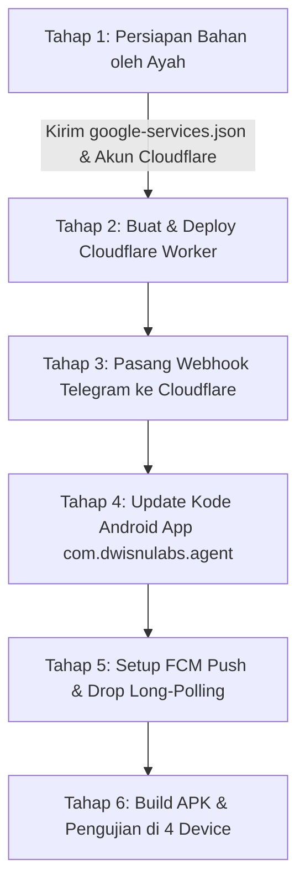

# BLUEPRINT ARSITEKTUR MULTI-DEVICE & HEMAT BATERAI (OPSI 2)
## Project: ChildLockAgent Multi-Device Control System

Dokumen ini adalah rencana komprehensif implementasi **1 Bot Terpusat untuk 4 Perangkat Anak** dengan **konsumsi baterai super hemat (hingga 95% lebih hemat)** menggunakan **100% infrastruktur gratis (*Free Tier / Forever Free*) tanpa memerlukan kartu kredit**.

---

## 1. Topologi Arsitektur Push-Based

```
[ Smartphone Ayah (Telegram) ]
              |
              | (Interaksi Tombol Menu: Pilih Anak / Kunci Semua)
              v
  [ Telegram Cloud API ]
              |
              | (HTTPS Webhook Instan)
              v
[ Cloudflare Worker (Free Serverless) ]
  * Menerima Webhook Telegram
  * Otentikasi ChatID Ayah
  * Routing Perintah berdasarkan Device ID
              |
              v
[ Google Firebase (Free Spark Plan) ]
  * Database Status 4 Perangkat (RTDB)
  * Firebase Cloud Messaging (FCM High-Priority Push)
              |
      +-------+-------+---------------+
      |               |               |
      v               v               v
[ Device 1: Note 9 ] [ Device 2: 9T ] [ Device 3: Pad SE ] [ Device 4: iQOO Z10 ]
  (Status: Tidur)     (Status: Tidur)   (Status: Tidur)       (Status: Tidur)
      |
      +---> Menerima Sinyal Push FCM (Hanya bangun jika ada perintah)
      +---> Eksekusi: Kunci Layar / Gertakan / Putus Internet
      +---> Kirim Laporan Balik ke Ayah di Telegram
```

---

## 2. Inventaris Produk & Layanan Gratisan

| Layanan | Peran Sistem | Batas Kuota Gratis (*Free Tier*) | Kebutuhan Kartu Kredit? |
| :--- | :--- | :--- | :---: |
| **Google Firebase (Spark Plan)** | *Push Notification (FCM)* & *Device Registry* | • FCM: **Unlimited (Gratis Selamanya)**<br>• Realtime DB: 1 GB Storage, 10 GB/bln | **TIDAK BUTUH** |
| **Cloudflare Workers** | Webhook Server Telegram Bot | • 100.000 request/hari (Penggunaan kita < 500/hari) | **TIDAK BUTUH** |
| **Telegram Bot API** | Antarmuka Pengendali (Chat & Tombol) | Unlimited | **TIDAK BUTUH** |

---

## 3. Checklist Bahan yang Perlu Anda Siapkan (Langkah Demi Langkah)

Berikut panduan langkah demi langkah yang perlu Anda siapkan. Semua dilakukan via browser di laptop:

### Langkah 1: Siapkan / Buka Akun Google Firebase
1. Buka browser dan kunjungi: [console.firebase.google.com](https://console.firebase.google.com/).
2. Login dengan akun Google/Gmail Anda.
3. Klik tombol **"Add project"** (Tambah project):
   * Beri nama project: `your-parental-project` (atau nama pilihan Anda).
   * Matikan toggle Google Analytics (tidak diperlukan, agar proses cepat).
   * Klik **Create Project**.
4. Di dashboard Firebase:
   * Klik ikon **Android** untuk menambahkan aplikasi:
     * **Android package name**: `com.dwisnulabs.agent`
     * **App nickname**: `ChildLock Agent`
     * Klik **Register app**.
   * Unduh file **`google-services.json`** yang disediakan oleh Firebase.
   * *Simpan file `google-services.json` ini di laptop (nanti akan kita masukkan ke folder `Parental/app/`).*
5. Di menu sebelah kiri Firebase Console:
   * Masuk ke **Build** -> **Realtime Database** -> Klik **Create Database** -> Pilih lokasi default (`United States` atau `Singapore`) -> Pilih mode **Start in test mode** -> Klik **Enable**.
6. Ambil Kunci Akses Server FCM:
   * Klik ikon **Gerigi (Project settings)** di pojok kiri atas -> tab **Cloud Messaging** / **Service accounts**.
   * Nanti kita ambil kredensial untuk Cloudflare Worker.

---

### Langkah 2: Siapkan Akun Cloudflare (Untuk Webhook Telegram)
1. Kunjungi: [dash.cloudflare.com/sign-up](https://dash.cloudflare.com/sign-up).
2. Daftar dengan email Anda (gratis, tanpa meminta input kartu kredit sama sekali).
3. Setelah login, klik menu **Workers & Pages** di sidebar kiri.
4. Klik **Create application** -> **Create Worker**.
5. Beri nama worker (misal: `dwisnu-parental-bot`) -> Klik **Deploy**.
6. Script JavaScript worker-nya tidak perlu Anda pusingkan, **kami yang akan membuatkan kodenya 100% lengkap dan siap tempel**.

---

### Langkah 3: Tetapkan Identitas 4 Perangkat Anak
Kita akan menyepakati 4 ID unik untuk masing-masing perangkat anak agar tombol di Telegram rapi:

| No | Device ID Internal | Label Tampilan di Telegram | Model HP & OS Target | Pengguna |
| :---: | :--- | :--- | :--- | :--- |
| 1 | `device_note9pro` | 👦 **Kakak (Redmi Note 9 Pro)** | Xiaomi MIUI 12 (Android 12) | Kakak |
| 2 | `device_redmi9t` | 👧 **Adik 1 (Redmi 9T)** | Xiaomi MIUI 12-14 (Android 11/12) | Adik 1 |
| 3 | `device_padse` | 📟 **Tablet (Redmi Pad SE)** | Xiaomi HyperOS (Android 13/14) | Bersama |
| 4 | `device_iqooz10` | 📱 **Adik 2 (iQOO Z10)** | Vivo Funtouch/OriginOS | Adik 2 |

---

## 4. Desain Tampilan Menu Bot Telegram Baru

Saat Anda membuka bot Telegram atau mengetik `/menu`, Anda akan disambut oleh panel kendali multi-perangkat:

```
🎮 PUSAT KENDALI PARENTAL (4 PERANGKAT)
━━━━━━━━━━━━━━━━━━━━
Pilih anak yang ingin dikendalikan, atau kirim perintah ke semua:

[ 👦 Kakak (Note 9 Pro) ]   [ 👧 Adik 1 (Redmi 9T) ]
[ 📟 Tablet (Pad SE)    ]   [ 📱 Adik 2 (iQOO Z10) ]
--------------------------------------------------
[ 🚨 KUNCI SEMUA (Broadcast) ]
[ 📶 PUTUS INTERNET SEMUA    ]
[ 📊 STATUS SEMUA PERANGKAT  ]
```

Ketika Anda mengetuk salah satu anak (misal: `[ 👦 Kakak (Note 9 Pro) ]`), muncul sub-menu khusus untuk anak tersebut:

```
📱 KENDALI: Kakak (Redmi Note 9 Pro)
Baterai: 82% | Status: Terbuka | Aplikasi: YouTube
━━━━━━━━━━━━━━━━━━━━
[ 🔒 Kunci Layar ]     [ 🔓 Buka Layar ]
[ ⏳ Buka 15 Menit ]   [ ⏳ Buka 30 Menit ]
[ 📶 Putus Internet ]  [ ⏳ Putus 30 Menit ]
[ 📱 Kelola Aplikasi ] [ 🎭 Tema Gertakan ]
[ ⬅️ Kembali ke Menu Utama ]
```

---

## 5. Roadmap Tahapan Pengerjaan



### Tahap 1: Pengumpulan Bahan (Saat Ini)
* Anda membuat project di Firebase Console dan mengunduh `google-services.json`.
* Anda mendaftar akun gratis di Cloudflare.

### Tahap 2: Pembuatan Cloudflare Worker
* Kami menuliskan kode script Cloudflare Worker yang menangani:
  * Verifikasi Chat ID Ayah.
  * Render menu multi-perangkat (Keyboard Inline).
  * Menembakkan perintah ke Firebase Realtime DB / FCM.

### Tahap 3: Integrasi Android SDK (Hemat Baterai)
* Mengganti loop `getUpdates` 20 detik yang boros dengan **Firebase Messaging Service (FCM)**.
* HP anak berada dalam status **Deep Sleep (100% adem dan irit)**. Begitu ada sinyal FCM data message masuk, Android membangunkan LockService dalam hitungan milidetik.

### Tahap 4: Kompilasi & Rollout ke 4 Perangkat
* Kita buat profil konfigurasi sederhana agar tiap HP otomatis mengenali dirinya sendiri (Note 9 Pro, Redmi 9T, Pad SE, atau iQOO Z10).
* Build APK dan instalasi bertahap ke masing-masing HP.
